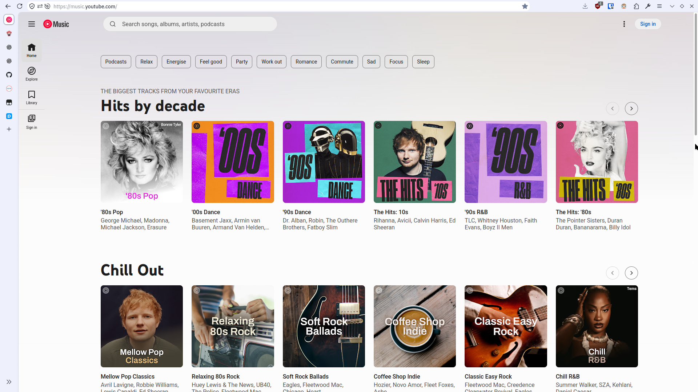

# youtube-music-tweaks

## what

you should probably use both of the scripts.. not sure but light mode can probably just be CSS? also light mode only applies if preferred colour scheme is set to light. ui tweaks does stuff like: fix ugly searchbar; make dim-on-hover more consistent; shift layout a bit idk

## screenshot?

it's a WIP ok

## how

download [tampermonkey](https://www.tampermonkey.net/) and the two JS files and drag them both into the dashboard

## stuff to fix

a lot

---

ok bye
